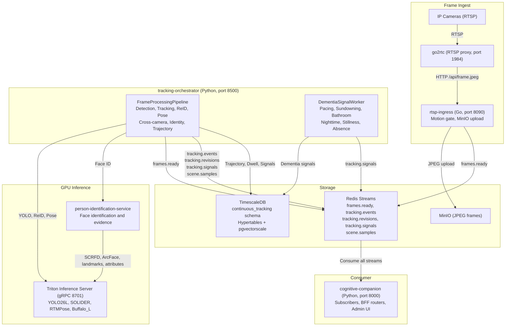

# Continuous tracking

The Continuous Tracking System (CTS) is a standalone service family at `continuous-tracking/` that provides multi-camera person tracking, Bayesian identity resolution, and dementia-relevant behavioral signal detection. It pulls RTSP camera streams, processes frames through a GPU-accelerated inference pipeline, and publishes results to Redis Streams. Cognitive Companion consumes these streams as a BFF gateway: every browser, MCP, and rule-engine path into CTS goes through the CC backend.

## When CTS is needed

Cognitive Companion without CTS provides single-frame perception: each camera event is an isolated batch analyzed by a vision LLM. This is sufficient for "is the stove on?" and "who is at the door?". It is not sufficient for questions that require continuous temporal context:

- Has a person been pacing in the hallway for the last 20 minutes?
- Is a bathroom dwell longer than the person's historical baseline?
- Is there a sundowning pattern building over the afternoon?
- Has a person left the house and not returned within their usual window?

CTS answers these by maintaining persistent, multi-camera tracks with stable identity over time.

## Beginner to advanced tracking series

For a progressive explanation of the floor-plane tracking work, start with
[Camera to Floor Basics](/features/continuous-tracking/01-camera-to-floor-basics) and continue
through the seven-page series. It covers why the live-map dot used to jitter, measurement
uncertainty, multi-camera fusion, posture fusion, floor-region visibility, and camera-drift
operations.

## System architecture

**Infrastructure**: TimescaleDB + pgvectorscale (StreamingDiskANN), Redis
Streams (AOF), MinIO, Triton Inference Server, and the person-identification
API. The DGX serves canonical FP32 Buffalo_L graphs through Triton's ONNX
Runtime backend. The Jetson profile uses target-built TensorRT plans from
explicit-Q/DQ graphs. Both profiles use the same service code path.

## Redis Streams

Protobuf-backed CTS streams carry raw protobuf bytes in a single field: no JSON and no base64.
The Python protobuf codec lives at `app/transport/codec.py`. Two auxiliary handoff streams
(`tracking.continuations` and `tracking.room_transitions`) carry flat string field maps via
`RedisStreamsTransport.publish()`.

| Stream | Direction | Field | Wire payload |
|--------|-----------|-------|--------------|
| `frames.ready` | consume (CTS reads) | `"frame"` | `continuoustracking.v1.FrameReady` |
| `tracking.events` | publish (CTS writes) | `"event"` | `continuoustracking.v1.TrackingEvent` (`identity_snapshots`) |
| `tracking.revisions` | publish | `"revision"` | `continuoustracking.v1.IdentityRevision` |
| `tracking.signals` | publish | `"signal"` | `continuoustracking.v1.DementiaSignal` |
| `scene.samples` | publish | `"sample"` | `continuoustracking.v1.SceneSample` |
| `cc.identity_assertions` | consume (CTS reads) | `"assertion"` | `continuoustracking.v1.CCIdentityAssertion` |
| `tracking.continuations` | publish | string field map | `PHContinuationCandidate` (`closed_ph_id`, `new_ph_id`, `from_room_id`, `to_room_id`, `gap_seconds`, `match_cost`, `occurred_at`) |
| `tracking.room_transitions` | publish | string field map | `RoomTransitionEvent` (`ph_id`, `identity_id`, `from_room_id`, `to_room_id`, `from_camera_id`, `to_camera_id`, `occurred_at`, `confidence`) |
| ~~`tracking.presence`~~ | retired in M37 | `"presence"` | `PresenceEvent` (`deprecated = true` in `tracking.proto`; no active producer) |
| ~~`tracking.dwell`~~ | retired in M37 | `"dwell"` | `DwellEvent` (`deprecated = true` in `tracking.proto`; no active producer) |

`tracking.events` is a live feed for the UI and `PersonLocationService`, throttled per camera by `live_publish_max_hz` (default 3 Hz; inference still runs every frame). Room presence segments and transitions are arbitrated in Cognitive Companion by `PersonLocationService`.

::: warning
Redis clients on protobuf streams must set `decode_responses=False` so binary payloads round-trip unchanged.
:::

## PostgreSQL schema

All CTS tables, indexes, triggers, and functions live in the `continuous_tracking` schema on the shared PostgreSQL instance. The baseline migration (`0001_init`) and incremental numbered `.up.sql` / `.down.sql` pairs in `tracking-orchestrator/migrations/` are managed by `MigrationRunner` with `pg_try_advisory_lock` for multi-replica safety.

Key tables and hypertables:

| Table | Type | Content |
|-------|------|---------|
| `tracking_events` | Hypertable | Per-frame tracking events with detections and identities |
| `person_trajectories` | Hypertable | Per-frame trajectory points with floor coordinates, posture, motion energy |
| `room_dwells` | Regular | Continuous room occupancy intervals with cumulative metrics |
| `dementia_signals` | Regular | Behavioral signal detections with severity and z-scores |
| `dementia_signals_daily` | Continuous aggregate | Daily rollup of signal counts by kind and severity |
| `tagged_keyframes` | Regular | Sampled JPEG keyframes with annotations |
| `person_hypotheses` | Regular | Physical-track entities (PHs) with identity assignments and per-orientation view prototypes; `ph_id` is the single cross-camera identifier |
| `reid_gallery` | Regular | Governed 4-state body-appearance gallery (`pending_review`, `auto_verified`, `operator_verified`, `rejected`) written only by `ReIDCandidateStage` |
| `identity_decisions` | Regular | Durable identity decision provenance rows and `gallery_review_events` audit trail |
| `ph_revisions` | Regular | Operator and automatic PH identity revision history |
| `face_observation_stats` | Regular | Per-camera face detection and match telemetry for readiness and calibration gates |
| `camera_topology_edges` | Regular | Learned directed handoff edges with transit-time distributions, used to gate cross-camera revival |
| `co_presence_links` | Regular | Same-identity links between open PHs in an overlap group (opposite-perspective cameras) |

## Boundaries

- Do not write to `dementia_signals` or `cts_cameras` tables outside the CTS services.
- Do not subscribe to `tracking.*` or `scene.*` streams outside the CC subscriber layer.
- Do not bypass the BFF: there is no path from browser or MCP into CTS internals that does not go through CC routers.
- Do not duplicate `_cts_enabled()`, `ns_to_iso()`, or `parse_ts()`. Import them from CC's CTS utility modules.

## Related pages

- [Jetson CTS Deployment](/hardware/jetson-cts): model selection, INT8 accuracy results, six-to-eight-camera sizing, and production qualification
- [Model Quantization](/hardware/model-quantization): representative calibration, selective PTQ and QAT, TensorRT internals, sparse INT8, and Intel or AMD portability
- [Camera to Floor Basics](/features/continuous-tracking/01-camera-to-floor-basics): start of the beginner-to-advanced floor tracking series
- [Why One Dot Jitters](/features/continuous-tracking/02-why-one-dot-jitters): measured before-and-after results for the fusion gates
- [Frame Processing Pipeline](/features/continuous-tracking/frame-pipeline): detection, tracking, ReID, cross-camera association, Bayesian identity resolution, and the identity feedback loop
- [Identity Integrity](/features/continuous-tracking/identity-integrity): accepted authority, gallery, revision, and cross-repository contracts with current implementation status
- [Dementia Signal Detection](/features/continuous-tracking/dementia-signals): signal kinds, hysteresis, baseline computation, and configuration
- [CC Integration](/features/continuous-tracking/cc-integration): enabling CTS, subscribers, rule examples, presence chain, and per-person alert profiles
- [Person Tracking](/features/person-tracking): single-camera face recognition, camera topology, room transitions
- [Composable Pipelines](/features/pipeline): full step-type reference and rule examples
- [Architecture](/guide/architecture): system overview including CTS subsystem
