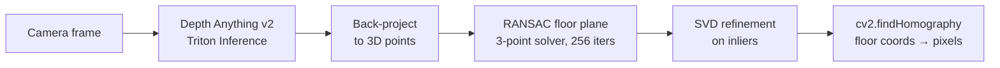

# Camera calibration

How camera calibration, shared views, and learned transitions work together so one person seen by several cameras stays one person on the floor plan.

## Overview

Three different relationships tie cameras to the floor plan and to each other. Each answers a different question and has one owner:

| Concept | Question it answers | Who sets it | Where |
| --- | --- | --- | --- |
| **Calibration** (homography) | Where on the floor is this pixel? | Operator, one camera at a time | Admin → CTS → Calibration |
| **Shared view** (overlap group) | Do these cameras see the same floor area at the same moment? | Operator, per set of cameras | Admin → CTS → Shared Views |
| **Learned transition** | How long does a walk from one camera's view to another's take? | Learned automatically from tracking | Admin → CTS → Shared Views (read-only) |

Overlap is not adjacency. Overlapping cameras see one person at the same instant; cameras along a walking route see them one after the other. Only the first needs operator input. Walk times between cameras are learned from accepted handoffs, so there is no transit graph to draw.

Two calibrated cameras already agree through the floor plan: their observations of one person land within a metre and merge. A shared view matters whenever at least one camera in the pair is not calibrated, because an uncalibrated camera tracks in its own virtual room and has no floor position to compare.

## Floor frame readiness

Cameras, rooms, transit zones, and (later) wearable anchors share one floor frame: the floor-plan image scaled to meters, with its origin at the image's top-left corner, x to the right, y down, and height measured above the floor. Until that frame exists, each camera tracks in its own 4 m virtual room, so one person seen by two cameras becomes two tracks and no speed or distance is real.

The frame is built in two tiers:

| Tier | What the operator provides | What it turns on |
| --- | --- | --- |
| 1 | Floor-plan image, a scale checked with a tape measure, a polygon for every room | Room attribution by polygon, transit zones, wearable anchor placement |
| 2 | A homography per camera within the residual budget, overlap groups, an acceptance walk | Cross-camera dedup by floor distance, walking speed and gait signals, trajectory matching |

**Scale check.** Measure two walls at right angles, each at least 3 m long, and set `floor_meters_per_pixel` so both agree with the plan within 2%. If they disagree by more, the plan image is not to scale; redraw it before continuing, because every later meter depends on it. Without a scale, the tracking orchestrator clears room polygons and transit zones.

**Residual budget.** A camera's `homography_residual_m` should be at or below 0.15 m when its floor view is within 5 m, and at or below 0.30 m otherwise. A camera that cannot meet the budget stays uncalibrated and keeps tracking in its virtual room. A low camera with no tilt (for example a shelf-top camera at 0.7 m) has a shallow floor view; leave it as a face camera inside an overlap group.

**What stays off on an uncalibrated camera.** Floor-distance dedup, walking speed (`floor_speed_m_s` is empty), room attribution by polygon (the camera's room assignment is used instead), and anything else that reasons in meters.

**Changes apply without a restart.** The orchestrator re-reads cameras, homographies, rooms, the floor plan, and overlap groups from Cognitive Companion every sync interval (60 s by default). A homography that Cognitive Companion no longer holds (cleared, rejected by validation, or on a disabled camera) is removed at the next sync, and the camera returns to its virtual room. A calibration preview that is never saved therefore stays in effect for at most one sync interval.

**Acceptance walk.** After calibrating, one person walks a marked path through each overlap area twice at normal speed with nobody else in view. The cross-camera agreement metric `cts_worldtracker_dedup_pair_distance_m` should have a median at or below 0.5 m and a 90th percentile at or below 1.0 m, the walker should have exactly one track at every instant, and walking speed should read between 0.8 and 1.6 m/s. Worse pair distances mean a biased homography: recalibrate the camera whose pairs are worst. A biased homography is worse than none, because it merges two people standing near each other or splits one.

| Metric | Meaning |
| --- | --- |
| `cts_worldtracker_observations_by_calibration_total{camera_id, calibrated}` | Observations per camera from a homography (`true`) or the virtual room (`false`) |
| `cts_worldtracker_dedup_pair_distance_m` | Floor distance of each calibrated cross-camera pair merged as one person |
| `cts_worldtracker_group_appearance_dedup_total` | Uncalibrated pairs merged by appearance inside an overlap group |
| `cts_overlap_groups_loaded` | Overlap groups the orchestrator currently applies |

## Homography calibration

A homography is a planar projective transformation. Given at least four pixel-to-floor-meter point correspondences, the system fits a 3×3 matrix `H` such that `H · [px, py, 1]ᵀ ∝ [fx, fy, 1]ᵀ`.

### Algorithm

The orchestrator uses OpenCV's `findHomography` with the RANSAC method:

```python
# tracking-orchestrator/app/calibration/homography.py
h_raw, _ = cv2.findHomography(src, dst, cv2.RANSAC, ransacReprojThreshold=3.0)
```

- **Input**: N ≥ 4 pixel → floor-meter point pairs
- **Output**: 3×3 matrix (row-major nested list) plus per-point reprojection residuals
- **RANSAC threshold**: 3.0 (pixel-space inlier distance)
- **Fails if**: points are collinear, fewer than 4 inliers, or `findHomography` does not converge

### Residuals and quality

After fitting, every input point is projected through the matrix and compared to its target:

```
residual[i] = euclidean_distance(H @ pixel[i], floor[i])
```

| Max residual | Status | Action |
|---|---|---|
| ≤ 0.25 m | `ok` | Accepted |
| ≤ 0.5 m | `warning` | Accepted, review recommended |
| > 0.5 m | `error` | Rejected with HTTP 400 |

Residuals are stored on `cts_cameras.homography_residuals` and displayed per-point in the calibration UI.

### Manual calibration (click-to-pick)

1. Load a camera snapshot
2. Click a point on the camera image to capture its pixel coordinate
3. Click the corresponding point on the floor plan to capture its meter coordinate
4. Repeat for at least 4 points spread across the camera frame
5. The homography preview updates on each point change (debounced)
6. Click **Calibrate** to save

Pixel coordinates are converted from screen-space to native camera resolution by compensating for `object-fit: contain` letterboxing. Floor coordinates are computed as `normalized_position × floor_plan_width_px × meters_per_pixel`.

### Auto-calibration (depth-based)

The auto-calibrate button uses the Depth Anything v2 model running on Triton to estimate metric depth from a single camera frame, then fits a floor plane via RANSAC and derives a homography without manual point placement:



**Confidence** is computed as `inlier_ratio × tightness` where `tightness = max(0, 1 − mean_inlier_distance / 0.2)`. Confidence below 0.10 rejects the result. A warning is shown below 0.50.

After auto-calibration, use the **Refine manually** button to populate 9 calibration points from the auto-computed matrix. Adjust any misaligned points, then re-save for improved accuracy.

## Visibility polygons

A visibility polygon is the projection of the camera's image boundary through the homography onto the floor plan. It answers: "what area of the floor plan does this camera see?"

### Computation

The function `compute_visibility_from_homography` in `backend/services/cts_visibility.py`:

1. Samples 80 points along the four edges of the camera image (20 points per edge)
2. Projects each through the homography matrix to get floor-meter coordinates
3. Dehomogenizes: `floor = [x/w, y/w]` for each projected point
4. Normalizes to [0, 1] relative to floor plan dimensions: `x_norm = floor_x_m / (fp_width_px × mpp)`
5. Returns 80 `[x_norm, y_norm]` pairs, or `None` if degenerate

The polygon is stored as `JSONB` on `cts_cameras.visibility_polygon` and updated automatically after every homography save.

### Degeneracy checks

The polygon computation returns `None` (degenerate) when any of these conditions hold:

| Condition | Meaning |
|---|---|
| `abs(w) < 1e-9` for any point | A boundary point projects to infinity (homography is singular) |
| `x_norm < -1.5` or `x_norm > 2.5` | Point projects more than 1.5 floor-plan-widths outside the plan |
| `y_norm < -1.5` or `y_norm > 2.5` | Same for Y axis |
| Floor plan dimensions ≤ 0 | Scale not configured |

When degenerate, the visibility polygon column stays `NULL`. The calibration result now includes `visibility_polygon_computed` (bool) and `visibility_polygon_warning` (string) so the operator knows immediately whether the coverage map will update.

### Floor plan scale

The most common cause of degenerate projections is an incorrect `floor_meters_per_pixel` value. This value converts floor-plan image pixels to real-world meters and is set in **Admin → Floor Plan → Upload tab**.

```text
mpp = known_real_world_distance_m / pixel_count_of_that_distance
```

For example: if a doorway known to be 1.0 m wide spans 68 pixels on the floor plan image, `mpp = 1.0 / 68 = 0.014706`.

If the uploaded floor plan has margins (borders, legends, whitespace), use the **Trim margins** crop tool before setting the scale. Draw a crop rectangle around the actual floor plan area and apply it: the cropped dimensions are used for all downstream calculations.

## Shared views (overlap groups)

A shared view is a set of cameras that see the same floor area at the same time, declared on **Admin → CTS → Shared Views**: name it, pick two or more cameras, and add it. Every camera must exist and appear once. Tracking reads the groups at its next sync, within a minute, without a restart; if a sync cannot read them, it keeps the groups it already has. Declare only what you have checked on site, and keep one group per area: a group never spans storeys.

Inside a group, tracking:

- **Merges by appearance.** Two same-perspective observations from uncalibrated cameras of the group are merged when their appearance similarity reaches `dedup_group_appearance_min_sim` (0.75) and no recognized faces conflict, since a virtual room has no floor distance to compare.
- **Links co-present tracks.** When two open tracks in the group resolve to the same committed identity at the same time (opposite viewpoints, where appearance similarity is low), tracking records a co-presence link instead of merging, so the system shows one person on two views.
- **Keeps appearance embeddings on.** The adaptive ReID cadence always embeds on a grouped camera, because the appearance merge needs an embedding from both cameras.

**Suggestions.** The page suggests groups for calibrated cameras whose floor coverage overlaps (visibility-polygon intersection over union of at least 0.05). A suggestion already covered by a declared group is hidden. Use a suggestion to pre-fill the form, then add any uncalibrated camera that sees the same area.

## Learned transitions

Every accepted cross-camera handoff updates a running mean and spread of the walk time for that ordered camera pair (`camera_topology_edges`). Cross-camera revival uses it as a gate:

- a camera pair with fewer than three learned walks never blocks, so the first handoffs are allowed and the topology can be learned;
- a crossing at or slower than the usual walk always passes, because people stop on the way (the revival age limit bounds how slow);
- a crossing much faster than the usual walk scores low and is rejected when it falls below `cross_camera_min_plausibility` (0.05), so a stranger appearing on a far camera a second after the resident left is not given the resident's track.

The Shared Views page lists the learned transitions read-only. A pair marked "learning" does not gate yet.

## End-to-end setup workflow

1. **Upload floor plan** (Admin → Floor Plan → Upload tab)
   - Select image, crop margins if needed
   - Set scale: click two points with a known real-world distance, or enter total width
   - Check the scale against two taped wall lengths (see [Floor frame readiness](#floor-frame-readiness))
   - Save, then draw a polygon for every room

2. **Calibrate cameras** (Admin → CTS → Calibration)
   - Select a camera, load a snapshot
   - Click-to-pick at least 4 point correspondences, or use Auto-calibrate
   - Verify residuals and visibility polygon status in the result card; the Calibration Health row marks each camera calibrated, not calibrated, or in error
   - Repeat for every camera that can meet the residual budget; **Remove calibration** returns a camera to its virtual room

3. **Declare shared views** (Admin → CTS → Shared Views)
   - Check the calibrated coverage map and the suggestions
   - One group per set of cameras that see the same floor area; include uncalibrated cameras that see it too
   - Compare duplicate tracks for a day before and after

4. **Verify** (acceptance walk, then the metrics in [Floor frame readiness](#floor-frame-readiness))
   - One track per walker at every instant
   - Learned transitions appear on the Shared Views page after people walk between cameras

## Next steps

- [Camera Setup Guide](/hardware/camera-setup): exposure, resolution, placement, and a post-mount validation checklist
- [Frame Processing Pipeline](./frame-pipeline.md): how calibrated floor positions flow through the pipeline
- [CC Integration](./cc-integration.md): how calibration data is served to the frontend
- [Architecture](/guide/architecture): overall system layout
