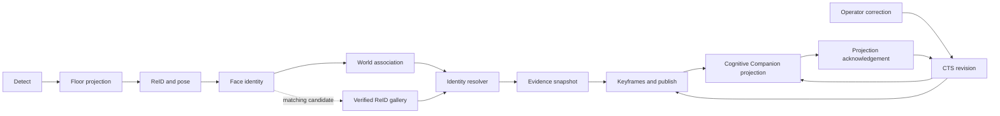

# Identity integrity architecture

Identity integrity keeps a physical track, a model inference, and a caregiver correction from
silently becoming the same thing. This architecture gives Continuous Tracking System (CTS)
developers and operators one set of boundaries for identity authority, ReID learning data, and
downstream corrections.

::: info Implementation status
The architecture decisions on these pages are accepted and deployed across `continuous-tracking`,
`cognitive-companion`, and `person-identification-service`. The initial synthetic failure baseline
was established on June 19, 2026, and the resolver, schema, governed four-state ReID gallery
(`pending_review`, `auto_verified`, `operator_verified`, `rejected`), physical-frame keyframe cards,
observation-bounded correction workflow, face confidence calibration, and `cc.identity_assertions`
protobuf cutover have shipped. Policy rollout modes (such as `face_id.evidence_policy` and
`face_templates.mode`) are listed in the configuration table below.
:::

## When to use this section

Use these pages when changing PH association, identity evidence, ArcFace response fields, the ReID
gallery, keyframe identity displays, or correction projections into Cognitive Companion.

The three architecture decisions define separate concerns:

| Decision | Question it answers |
| --- | --- |
| [Identity authority and Unknown](/features/continuous-tracking/identity-integrity/identity-authority) | Which evidence may assign a household identity, and when must the result be Unknown? |
| [ReID gallery governance](/features/continuous-tracking/identity-integrity/reid-gallery-governance) | Which body embeddings may vote, how are they reviewed, and what is deleted after rejection? |
| [Identity revision projections](/features/continuous-tracking/identity-integrity/revision-projections) | How does an immutable inference become a corrected effective label across services? |

## System at a glance

A `PersonHypothesis` (PH) remains the one persistent world-coordinate track. Identity is a governed
property of that PH. The system does not create a parallel identity tracker.

Five concepts stay separate throughout this flow.

| Concept | Owner | Meaning |
| --- | --- | --- |
| Observation association | CTS world tracker | Chooses which physical observation updates which PH |
| Inferred identity | CTS resolver | Stores what the models and prior reported at observation time |
| Effective identity | CTS revision projection | Applies authority and corrections to the label consumers use |
| Operator correction | CTS correction service | Records immutable truth over an explicit observation range |
| Learning data | CTS gallery service or ArcFace enrollment | Uses its own review and provenance rules |

## Initial baseline and deployed resolution

The table below pairs the June 2026 characterization baseline with the deployed implementation.

| Area | Initial baseline (2026-06) | Deployed behavior |
| --- | --- | --- |
| Temporal prior | `resolver.prior_maintenance_max_age_s` was `120.0`; ordinary held decisions could rewrite `current_identity_committed_at` | A 30-second window (`prior_maintenance_max_age_s: 30.0`) measured strictly from independent qualifying sensory evidence |
| Duplicate active identity | `enable_duplicate_active_identity_guard` was `false`; the resolver recorded a shadow mismatch | `enable_duplicate_active_identity_guard: true` enforced; at most one open global PH may hold a household identity outside declared co-presence links |
| ReID gallery | `reid_gallery` had `face_confirmed` but no lifecycle state or crop provenance | Governed 4-state lifecycle (`pending_review`, `auto_verified`, `operator_verified`, `rejected`) with crop provenance; only `VOTING_STATES` (`auto_verified`, `operator_verified`) younger than `gallery_vote_max_age_s` (12 h) vote |
| Gallery seeding | A recognized face was required, but the face identity was not compared with the seed label | `ReIDCandidateStage` requires the direct recognized face identity to equal `committed_identity_id` with `calibrated_confidence >= 0.80` (`>= 0.90` for `auto_verified`) |
| Keyframes | Bbox rows contained each visible identity, while the list card exposed only the trigger PH identity | Grouped physical-frame cards (`GET /internal/keyframes/grouped`, `/api/v1/cts/keyframes`) aggregate every effective bbox identity |
| Face confidence | Person identification reported raw ArcFace cosine similarity as `confidence` | Distinct `similarity` (raw cosine similarity) and nullable `calibrated_confidence` fields deployed on `person-identification-service` |
| CC assertions | `cc.identity_assertions` used separate text fields | One raw `CCIdentityAssertion` protobuf payload consumed by `CCIdentityAssertionSubscriber` and matched in `WorldTrackingStage` |

## Data ownership

CTS tables live in the `continuous_tracking` PostgreSQL schema. Cognitive Companion uses its own
Alembic-managed database. The gallery table is `reid_gallery`; there is no `identity_gallery`
table.

| Object | Current purpose | Identity owner |
| --- | --- | --- |
| `person_hypotheses` | Persistent PH and current identity | CTS association state |
| `world_observations` | Observation history linked to PHs | CTS correction boundary source |
| `reid_gallery` | 768-dimensional body embeddings across 4 governed states | CTS governed gallery |
| `identity_decisions` and `gallery_review_events` | Durable identity decision provenance and gallery review audit log | CTS identity provenance |
| `face_observation_stats` | Per-camera face detection and match telemetry for readiness and calibration gates | CTS face readiness telemetry |
| `tagged_keyframes` | Sampling-trigger rows that reference raw frames | CTS physical-frame read model |
| `keyframe_bbox_annotations` | Every persisted bbox for a sampled frame | CTS bbox identity projection |
| `ph_revisions` | PH identity revision audit and range lineage | CTS revision lineage |
| `cts_identity_revision_log` | Applied CTS revision IDs in Cognitive Companion | Cognitive Companion projection audit |
| `presence_segments` and `location_observations` | Unified location history with revision supersession (`PersonLocationService`) | Cognitive Companion location projection |

## Identity-related configuration

These values describe the current defaults in `tracking-orchestrator/config/settings.yaml` and
`person-identification-service/config/settings.yaml`.

| Name | Current value | Current mode |
| --- | --- | --- |
| `face_id.enabled` | `true` | Face identification calls are live |
| `face_id.cooldown_s` / `identification_point_cooldown_s` | `5.0` / `1.0` | Role-based query cooldown (`5.0` s for `mixed`/`surveillance`, `1.0` s for `face_capable`) |
| `face_id.min_raw_similarity` | `0.6` | Raw similarity gate for recognized face anchors under the `legacy` evidence policy |
| `face_id.evidence_policy` | `shadow` | Live faces follow `legacy` while `calibrated` decisions are measured alongside; switch to `calibrated` once household calibration is fitted |
| `resolver.face_commit_min_similarity` | `0.70` | Uncalibrated face-lock gate (raw similarity) under `legacy`/`shadow` |
| `resolver.uncalibrated_face_max_likelihood` | `0.55` | Cap on uncalibrated face anchors when `face_id.evidence_policy` is `calibrated` |
| `resolver.commit_prob` | `0.65` | Posterior commit threshold |
| `resolver.commit_margin` | `0.15` | Posterior margin threshold |
| `resolver.prior_maintenance_max_age_s` | `30.0` | Enforced 30-second maintenance window measured from independent sensory evidence |
| `resolver.enable_quality_gate` | `true` | Enforced |
| `resolver.enable_flip_debounce` | `true` | Enforced |
| `resolver.enable_sticky_maintenance` | `true` | Enforced |
| `resolver.enable_duplicate_active_identity_guard` | `true` | Enforced |
| `resolver.enable_multiview_gallery` | `true` | Live gallery query path over `VOTING_STATES` |
| `resolver.gallery_vote_max_age_s` | `43200.0` | 12-hour voting cutoff for verified body-appearance embeddings |
| `resolver.face_quality_mode` | `shadow` | Measures quality-weighted face likelihood in shadow metrics |
| `face_templates.mode` | `off` | Multi-frame face template matching (`off`, `shadow`, `enabled`) |
| `reid_candidates.auto_verify_min_confidence` | `0.90` | Calibrated confidence threshold for minting directly into `auto_verified` (`>= 0.80` enters `pending_review`) |
| `pipeline.adaptive_reid.enabled` | `false` | Live inference skipping is disabled |
| `pipeline.adaptive_reid.shadow` | `true` | Shadow evaluation only |
| `recognition.threshold` | `0.4` | Raw ArcFace recognized threshold |
| `recognition.unknown_threshold` | `0.25` | Raw ArcFace unrecognized threshold |

## Service and storage ownership

All local compose services join the external `nanai` Docker network. MinIO is external to these
compose files.

| Service | Default host port | Database or state | Identity responsibility |
| --- | ---: | --- | --- |
| Shared PostgreSQL | deployment configured | `continuous_tracking`, `cognitive_companion`, `person_identification` | Separate data ownership per service |
| Redis | `6379` | Redis Streams and consumer state | Cross-service event transport |
| Triton | `8700`, `8701`, `8702` | Model repository | Detector, ReID, pose, and ArcFace inference |
| Tracking orchestrator | `8500` | `continuous_tracking` | PH, resolver, gallery, keyframes, and corrections |
| RTSP ingress | `8090` | Redis and MinIO | Frame publication |
| go2rtc | `1984` | Camera proxy configuration | Camera session proxy |
| Cognitive Companion backend | `8000` | `cognitive_companion` | BFF and downstream projections |
| Cognitive Companion frontend | `8081` | None | Caregiver administration |
| Person identification | `8200` | `person_identification` | ArcFace enrollment and identification |

RTSP ingress stores source JPEGs under
`frames/{camera_id}/{YYYY/MM/DD/HH}/{frame_index}-{capture_time}.jpg`. A keyframe references this raw
object. It is not a separately rendered image. Governed ReID review crops use separate immutable
object keys under the governed ReID review lifecycle.

## Synthetic characterization

The baseline includes synthetic fixtures for seven failure modes: exchanged labels, one person handed between
two PHs, duplicate active identity, prior timestamp renewal, mismatched gallery seeding, keyframe
identity collapse, and a missing calibration artifact. Private household frames and populated
manifests stay outside Git.

The characterization tests use strict xfails tied to the milestone that removes each defect. An
unexpected pass fails the test run, which forces the xfail to be removed when the behavior changes.

## Related pages

- [Cross-repository identity contracts](/features/continuous-tracking/identity-integrity/contracts)
- [Visitor identities](/features/continuous-tracking/identity-integrity/visitor-identities) (written
  for a caregiver, not an engineer: what is stored about a recurring unnamed visitor and how to name
  or dismiss one)
- [Identity-integrity verification](/development/identity-integrity-verification)
- [Tracking concepts](/features/continuous-tracking/tracking-concepts)
- [CC integration](/features/continuous-tracking/cc-integration)
