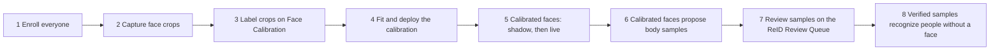

# Identity setup

Cameras can follow a person from room to room without knowing who they are. Putting a name on that person takes a short chain of setup work that crosses three services, and every link has to be in place before the next one can do anything. The **Identity Setup** page in Cognitive Companion (People, Identity Setup, `/admin/identity-setup`) shows which link is broken in your home today and what to do next.

## The chain

| Link | What happens | Where |
| --- | --- | --- |
| 1 Enroll everyone | Five to ten photos of every person who lives in or regularly visits the house, starting with the person you care for; then review recurring faces on the Visitors page, where most groups are usually faces of someone enrolled | People, Members & Enrollment; People, Visitors |
| 2 Capture | The person identification service keeps a sample of real faces from your cameras for 7 to 14 days | `calibration_capture.enabled` in the person identification settings |
| 3 Label | An admin says who each captured face is, or that it is someone not enrolled | People, Face Calibration |
| 4 Fit and deploy | The labeled faces produce a calibration artifact that turns a face score into a trustworthy probability | [Face confidence calibration](/development/face-confidence-calibration) |
| 5 Calibrated faces | The tracking orchestrator weighs faces by that probability, first in shadow mode, then live | `face_id.evidence_policy` in the tracking orchestrator settings |
| 6 and 7 Body samples | When a calibrated face confirms the person a track is following, the system proposes a body-appearance sample for review | Tracking, ReID Review Queue |
| 8 Recognition without a face | Verified samples let the system keep a name on someone walking away from a camera | Automatic |

Face Calibration and the ReID Review Queue are two different stages of this one chain. Face Calibration labels face crops and never changes who is enrolled. The ReID Review Queue never shows faces: it governs which body-appearance samples the system may learn from, and it stays empty until calibrated faces are live. Both pages link to Identity Setup.

Two prerequisites sit beside the chain. **Cameras deliver frames**: a camera that has sent nothing for a minute contributes nothing. **Floor plan, rooms, and camera calibration**: without a floor plan at a measured scale, room outlines, and a calibration for each tracking camera, one person seen by two cameras can become two tracks (see [Camera calibration](/features/continuous-tracking/camera-calibration)). A camera with the `face_capable` role is an identification point and needs no floor calibration.

## One way to say who someone is

You decide who someone is in several places: labeling faces, reviewing recurring faces, reviewing body samples, and correcting a track. They work at different stages of the system, but every one picks from the same list of household members, in the same order, with the same names. Face labeling, recurring-face review, and body-sample review also share their words and keys: a number picks a household member, **n** means someone not in the household, and **x** means not usable. Recurring faces add **Someone new** and offer one **Dismiss** for both negative choices, because a dismissed group closes the same way either way. Each page shows, before you confirm, what the choice will change, in words that come from the system itself, and says under its buttons which choices can change enrollment. Only naming someone new adds faces to a person's enrollment; every other decision leaves how the system recognizes people by face unchanged. Choosing a member on a body sample still asks you to confirm, because it lets that sample vote. To decide about many items at once, use **Select several** on Recurring faces, Face Calibration, and the ReID Review Queue. On Face Calibration and the ReID Review Queue a group decision can only say "not in the household" or "not usable": naming a member there, which teaches the system what that person looks like, is always done one face or sample at a time.

The page also lists every review queue (Visitors, Face Calibration, the ReID Review Queue) with how many items are waiting and a link to each. A queue whose service did not answer says **Count unavailable**, never zero.

## Reading the page

Each step shows one state and, when something is needed, one next action. The first blocked step is marked **Start here**.

| State | Meaning |
| --- | --- |
| Ready | This step is done |
| Needs attention | Progress is possible or under way, and something is worth doing |
| Blocked | Nothing after this step can progress until it is done |
| Unknown | The service this step reads from did not answer; check that it is running |

A step whose source is down shows **Unknown** and never guesses: a stopped person identification service never reads as "everyone is enrolled". The other steps still show their real state. Face templates, wearables, and **Wearable teaching** appear as optional steps; they improve recognition after calibrated faces are live and never block the chain. When a wearable tag's teaching is paused after a suspected swap or revocation, the Wearable teaching step flags it and links to the Wearables page so an admin can resume teaching once the tag is back on the right person.

Some next actions link to an admin page. Others are deliberate configuration changes that need a restart, such as turning on capture or switching the face evidence policy, so the page says which setting to change instead of offering a switch.

::: warning The page cannot see who is missing
Roster checks cover the people listed under People. If the person you care for was never added there, nothing can notice. Add every resident first: until they are enrolled, the system can only match their face to whoever else is enrolled.
:::

## The same answer for agents

`GET /api/v1/identity/readiness` (permission `identity_readiness:read`, held by the caregiver roles) and the read-only MCP tool `get_identity_readiness` return the same ordered steps, each with `key`, `state`, `detail`, `next_action`, and `optional`, plus `blocking_step`. The response carries counts and settings only, never an identity id. The tracking orchestrator's part comes from its internal `GET /internal/identity/readiness`: the face, template, quality, and assertion policies it runs with, ReID gallery rows by state, and which enabled cameras have a floor calibration in use.

## Related pages

- [Face confidence calibration](/development/face-confidence-calibration)
- [ReID gallery governance](/features/continuous-tracking/identity-integrity/reid-gallery-governance)
- [Visitor identities](/features/continuous-tracking/identity-integrity/visitor-identities)
- [Camera calibration](/features/continuous-tracking/camera-calibration)
