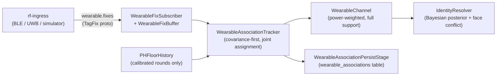

# Wearable identity evidence

Status: implemented (ships `wearable.mode: off`; shadow and enable roll out by config).

Wearable localization supplies an independent, non-visual identity channel alongside face
recognition and appearance ReID. It turns hardware-neutral `TagFix` messages emitted by
`rf-ingress` into governed wearable-to-PH associations, graded attestation segments, and a
power-weighted `WearableChannel` likelihood for the Bayesian identity resolver.

## Architecture and data flow

1. **Fix intake (`WearableFixSubscriber` and `WearableFixBuffer`):** Consumes `wearable.fixes`
   only when `wearable.mode` is `shadow` or `enabled` (when `off`, no subscriber connects).
   Enforces every protobuf presence flag, drops `OFF_BODY` and stale fixes (older than
   `wearable.max_fix_age_s`, default `15.0 s`), resolves the wearing resident through
   `WearableSiteConfig.member_at(tag_id, measured_at)`, dead-letters malformed messages with
   counters (`cts_messages_dead_lettered_total{stream="wearable_fixes"}`), and buffers accepted
   fixes ordered by `measured_at` so micro-batched bursts stay aligned to physical capture time.
2. **Calibrated PH floor history (`PHFloorHistory`):** Records `(captured_at, x_m, y_m, cov_m2,
   speed_m_s)` only on tracker rounds updated by calibrated observations. Uncalibrated virtual
   floor coordinates and coasting predictions never enter history. History survives close-and-revive
   windows (`ph_close_grace_s + revive_max_age_s`, 45 s) and resets on PH split or merge.
3. **Pure association and graded attestation (`WearableAssociationTracker`):** Runs once per
   tracker round with zero gallery or appearance inputs, so association and attestation are
   strictly independent of the ReID gallery.
4. **Once-per-round persistence (`WearableAssociationPersistStage`):** Persists segment open,
   attestation-upgrade, and close transitions into `continuous_tracking.wearable_associations`
   ahead of `PublishStage`'s live UI rate limit across all three pipeline execution paths.

## Covariance-first evidence classes

Association never branches on hardware vendor, adapter kind, or radio technology. Evidence class
is derived solely from fix kind and the major-axis standard deviation of the 2x2 horizontal
covariance (`sigma_major_m = sqrt(lambda_max(Sigma_f))`):

| Class | Qualification | Scoring model | Shared room (2+ open PHs) |
| --- | --- | --- | --- |
| `trajectory` | `FIX_KIND_POSITION` with `sigma_major_m <= wearable.trajectory_max_sigma_m` (`0.75 m`) and calibrated PH history | Innovation covariance `S = Sigma_f + Sigma_j + (v_j * sigma_t)^2 I + sigma_bias^2 I` (`sigma_t = 0.5 s`, `sigma_bias = 0.15 m`, chi-square gate `9.21`, penalty `-4.0`), evaluated at interpolated `fix.measured_at` | Can disambiguate when trajectories separate by `margin >= 4.0` |
| `room` | `FIX_KIND_ROOM`, wide-covariance `FIX_KIND_POSITION` reduced over room polygons by Gauss-Hermite quadrature (dropping rooms `< 0.05` mass), or uncalibrated PH | Room LLR with `room_match_eps = 0.1`, requiring summed room mass `>= 0.7` of window fixes | Always refused (`uncalibrated_shared_room`); requires sole open PH for the entire 10 s window |

## Safety guards

- **Joint 1-to-1 assignment with margins:** Members and open PHs are paired jointly via
  `linear_sum_assignment` with unmatched dummy columns (cost `0.0`). An accepted pair must clear
  `min_fixes` (`5`), `min_window_llr` (`6.0`), and both tag-side and PH-side margins
  (`min_margin_llr = 4.0`). Ambiguous pairs stay `Unknown` and are counted under
  `ambiguous_two_phs`, `ambiguous_two_tags`, or `ambiguous_tie`.
- **Parked tags yield zero evidence:** A tag with no room change and sustained stillness
  (`MOTION_STATE_STILL`, or `MOTION_STATE_UNSPECIFIED` positions remaining within their own 95%
  covariance ellipse) for `wearable.parked_after_s` (`600 s`) is marked `parked` and yields zero
  evidence until `MOVING` or a room change. A tag already present in a room before a PH appears
  earns no room-class evidence for that PH until it reports `MOVING` after the PH appeared.
- **Multiple tags per person:** Fixes are grouped by bound `member_id` before joint assignment.
  Each member is scored by its best single tag (scores are never summed across tags). When two
  non-parked tags of one member disagree on room for `wearable.tag_disagreement_window_s` (`10 s`),
  the member yields zero evidence (`tag_disagreement`). For a dual-mode watch carrying both
  continuous BLE room fixes and a 12-second micro-batched UWB burst, the UWB trajectory stream
  disambiguates shared rooms while active, and the continuous BLE stream resumes refreshing the
  independent-evidence clock whenever the wearer is alone in a room.

## Graded attestation

Persisted segments in `continuous_tracking.wearable_associations` carry an explicit
`attestation_grade` (`none`, `room`, or `trajectory`):

| Grade | Requirements |
| --- | --- |
| `trajectory` | Continuous trajectory-class acceptance spanning at least `10.0 s` and `8` trajectory fixes, `window_llr >= 15.0`, both margins `>= 4.0`, zero face conflicts |
| `room` | Continuous room-class acceptance spanning at least `60.0 s`, sole open PH throughout, tag reported `MOVING` at least once in span, tag entered room within `20.0 s` of the PH appearing in it, zero face conflicts |
| `none` | Active or closed association that has not met either bar, or whose attestation was broken by a face conflict |

## Resolver integration and swapped-wearable conflict rule

`WearableChannel` maps `window_llr` into probability
`p_w = min(cap, logistic((window_llr - llr_mid) / llr_scale))` (`p_max = 0.97` for trajectory,
`p_max_room = 0.90` for room; `llr_mid = 8.0`, `llr_scale = 3.0`), spreads `1 - p_w` uniformly
across all other enrolled identities plus `UNKNOWN`, applies `wearable.weight_multiplier` (`2.0`)
as a log-likelihood power (`p ** weight`) before normalization, and returns `support_multiplier = 1.0`.

- **Evidence grade (`WEARABLE`):** Refreshes the independent-evidence clock using the physical
  `newest_fix_at`, ranks contenders in the duplicate-active guard when
  `p_w >= wearable.duplicate_guard_min_probability` (`0.90`), never bypasses an incumbent open
  PH, and never grants authority over operator corrections or calibrated direct face.
- **Calibrated direct-face vs. wearable conflict:** When a qualifying calibrated direct-face
  authority anchor (`calibrated_confidence >= resolver.arcface_authority_calibrated_confidence`,
  `0.80`) names identity A while accepted live wearable evidence on the same PH names identity B
  (`A != B`), the resolver forces `Unknown` (`conflict="wearable_face"`), increments
  `cts_wearable_face_conflict_total`, and breaks attestation on the segment. Three or more
  conflicts for one tag within 10 minutes mark `swap_suspected = true` on the segment and emit a
  warning log referencing `tag_id` only (never person names). An uncalibrated face
  (`calibrated_confidence` is null, such as a resident not yet covered by calibration) never
  triggers this conflict.

## Rollout, observability, and retention

- **Modes (`wearable.mode`):** `off` (default; zero runtime overhead, no stream subscription),
  `shadow` (runs association, persists `wearable_associations` rows, and counts counterfactual
  outcomes in `cts_wearable_shadow_outcomes_total{outcome}` without changing live identity), and
  `enabled` (live `WearableChannel` evidence and conflict handling).
- **Read-only inspection:** `GET /internal/identity/readiness` reports `wearable_mode` and
  `wearable_active_associations` (aggregate counts only), and
  `GET /internal/wearables/associations` lists recent or active association segments.
- **Privacy and purge:** Purging a resident deletes all matching rows in
  `continuous_tracking.wearable_associations`, buffered fixes, and in-memory bindings. Unknown-PH
  maintenance cascades `wearable_associations` deletes via `ON DELETE CASCADE`.

## How the wearable teaches the cameras

An attested association is sensor evidence that a member was on a track for an interval. Four
learners can use it, each behind its own setting and all off by default. They exist so the cameras
recognize a person on days and in rooms where no wearable is present.

| Learner | Trajectory grade | Room grade | Setting |
| --- | --- | --- | --- |
| Body-appearance samples | minted `auto_verified` with `seed_source = wearable_attested`, voting at trust 1.25 | minted `pending_review` with `seed_source = wearable_room_attested`; votes only after a caregiver approves it | `reid_candidates.wearable_seeding_enabled` |
| Face exemplars | the PH's emitted faces go to the person-ID service as `attested` captures for audit and optional promotion | same, tagged with the grade | `wearable.supervision.face_attestation` |
| Unknown-history backfill | identity-NULL rows over the attested segment are relabeled (NULL-only) | never | `resolver.enable_wearable_backfill` |
| Image-only evaluation | truth for scoring what images alone decide | truth, reported separately | `wearable.evaluation.sample_rate` |

- **Seeding needs the live channel.** Startup refuses `reid_candidates.wearable_seeding_enabled`
  unless `wearable.mode` is `enabled`, because an `auto_verified` sample votes at once.
- **A face of someone else vetoes.** A seed or an offered face is dropped when any face on that
  detection, live or shadow-only, was recognized as another person, at any similarity.
- **Spacing and caps.** At most one wearable seed per person and body orientation every 120 s,
  none that is a near-duplicate (cosine above 0.92) of a same-day sample, and at most 10
  room-grade seeds per person per day, so the review queue stays short.
- **Backfill waits on the owner.** Backfilling attested intervals is implemented and off; it stays
  off until the owner confirms that attested intervals may relabel history.

### Measuring the benefit

For a sampled share of attested resolutions the resolver decides the PH twice without the
wearable channel and as if it held no identity: a control arm without any wearable-taught sample
and a treatment arm with them. In both arms no sample seen in the last 10 minutes votes, so a
sample cannot vote for the stretch that minted it and the two arms differ only in older
wearable-taught samples. Seconds per arm, outcome (`correct`, `wrong`, `unknown`), and grade
accumulate in `cts_image_only_eval_seconds_total` and, per person and UTC day, in
`continuous_tracking.image_only_evaluation_daily`. `scripts/image_only_evaluation_report.py`
reports the attribution and wrong rates per arm and the treatment-minus-control difference with a
bootstrap 95% interval over days.

On the simulator replay that ships with the tests, a resident wears a tag for 15 minutes and then
returns without it. While the tag is worn, the treatment arm names the resident for 588 s and the
control arm for 0 s (the first 300 s are Unknown in both, the exclusion window). After the tag comes
off, the taught cameras name the resident in 148 of 150 rounds and untaught cameras in none. A
returning person has no gallery samples of their own, so recognizing them after the tag comes off
relies on per-view queries from the track's own appearance (`resolver.enable_multiview_gallery`,
on in the shipped settings); the replay runs with that setting. These are simulator numbers; the
household measurement starts when wearables are installed.

## Related pages

- [Identity authority and Unknown](/features/continuous-tracking/identity-integrity/identity-authority)
- [Cross-repository identity contracts](/features/continuous-tracking/identity-integrity/contracts)
- [ReID gallery governance](/features/continuous-tracking/identity-integrity/reid-gallery-governance)
